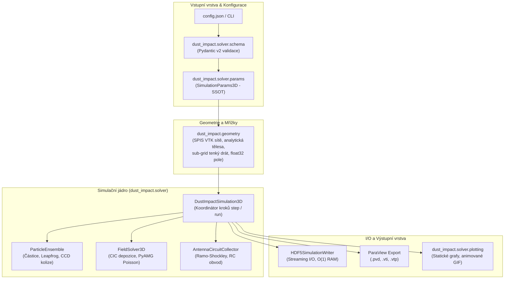
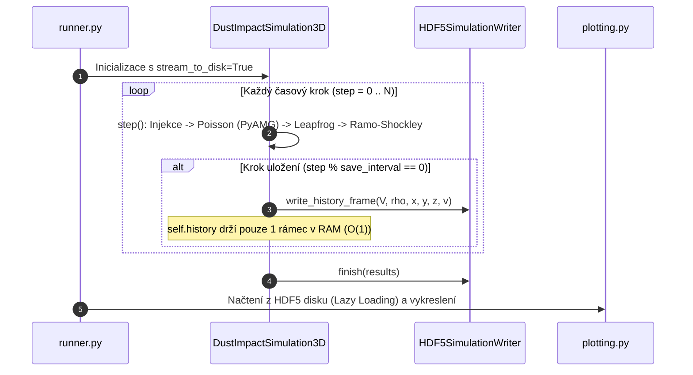

# 🚀 Architektura a logika 3D PIC Simulátoru (`dust_impact.solver`)

Tento dokument definuje systémovou architekturu, datový workflow, paměťové schéma a fyzikálně-numerická specifika 3D simulátoru hyperrychlých dopadů prachu v kanonickém balíčku `dust_impact.solver`.

Simulátor je navržen pro detailní analýzu a modelování signálů na vesmírných sondách (např. Solar Orbiter, Parker Solar Probe, Cassini, laboratorní experimenty), kde dopad mikrometeoroidu rychlostí desítek km/s generuje oblak hustého impaktního plazmatu. Rychlá expanze tohoto oblaku v elektrostatickém poli sondy a okolního plazmatu slunečního větru způsobuje komplexní elektromagnetické rušení, indukci napětí a sběr náboje na detekčních anténách.

---

## 1. High-Level Architektura a Modulární Dekompozice

Systém je striktně modulární a odděluje fyzikální a numerické jádro (backend) od uživatelského rozhraní, I/O operací a vizualizace (frontend). 

Architektura kombinuje dva klíčové principy:
- **Data-Oriented Design (DOD)**: V horkých smyčkách výpočetního jádra pro maximální paměťovou propustnost a využití CPU cache (operace nad velkými souvislými bloky NumPy polí).
- **Object-Oriented Programming (OOP) & Separation of Concerns (SoC)**: Rozdělení simulačního jádra do specializovaných subsystémů s jedinou odpovědností.



### Přehled modulů v `dust_impact.solver`:

| Modul | Odpovědnost a klíčové komponenty |
| :--- | :--- |
| **[`runner.py`](file:///C:/Projects/Phd/SPIS/PostProcessSPIS/dust_impact/solver/runner.py)** | Řídí celkový lineární workflow: validace $\to$ sestavení geometrie $\to$ kontrola CFL stability $\to$ inicializace streamingu $\to$ spuštění PIC výpočtu $\to$ exporty a vizualizace. |
| **[`sim_core.py`](file:///C:/Projects/Phd/SPIS/PostProcessSPIS/dust_impact/solver/sim_core.py)** | Hlavní koordinátor `DustImpactSimulation3D`. Poskytuje atomickou metodu `step()` a metodu `run()` s podporou paměťového zastropování `stream_to_disk=True`. |
| **[`ensemble.py`](file:///C:/Projects/Phd/SPIS/PostProcessSPIS/dust_impact/solver/ensemble.py)** | Třída `ParticleEnsemble`: správa fázového prostoru elektronů a iontů, injekce oblaku, Continuous Collision Detection (CCD) proti sondě a sub-grid detekce tenkých drátů antén. |
| **[`field_solver.py`](file:///C:/Projects/Phd/SPIS/PostProcessSPIS/dust_impact/solver/field_solver.py)** | Třída `FieldSolver3D`: Cloud-in-Cell (CIC) trilineární depozice náboje, algebraický multigrid (PyAMG) řešič Poissonovy rovnice $-\nabla^2 V = \rho / \varepsilon_0$ a interpolace polí. |
| **[`collector.py`](file:///C:/Projects/Phd/SPIS/PostProcessSPIS/dust_impact/solver/collector.py)** | Třída `AntennaCircuitCollector`: výpočet indukovaných proudů podle Ramo-Shockleyova teorému, evidence sbíraného náboje z absorbovaných částic a integrace RC obvodu předzesilovače. |
| **[`schema.py`](file:///C:/Projects/Phd/SPIS/PostProcessSPIS/dust_impact/solver/schema.py)** | Deklarativní validační modely Pydantic v2 (`SimulationConfigSchema`, `GeometrySchema`, `PhysicsSchema`, `NumericSchema`, `PlottingSchema`). Zajišťuje striktní typování (`extra='forbid'`) a generuje `config.schema.json`. |
| **[`params.py`](file:///C:/Projects/Phd/SPIS/PostProcessSPIS/dust_impact/solver/params.py)** | Dataclasses s dynamickými `@property` gettery a settery (`SimulationParams3D`). Slouží jako jediný zdroj pravdy (SSOT) pro rozměry domény a mřížkové kroky $dx, dy, dz$. |
| **[`config_loader.py`](file:///C:/Projects/Phd/SPIS/PostProcessSPIS/dust_impact/solver/config_loader.py)** | Načítání JSON konfigurace, mapování zvalidovaného schématu na runtime objekty, normalizace cest a adaptivní přesměrování výstupních adresářů. |
| **[`plotting.py`](file:///C:/Projects/Phd/SPIS/PostProcessSPIS/dust_impact/solver/plotting.py)** | Prezentační vrstva: generování signálových grafů (proudy $I(t)$, napětí $V(t)$), prostorových 2D/3D řezů, fázového prostoru a animovaných GIFů. |

---

## 2. Datový Workflow, I/O a HPC Paměťové Paradigma

3D PIC simulace plazmatu generují rozsáhlá prostorová pole. Systém proto implementuje následující paměťové a I/O optimalizace:



1. **Deklarativní validace konfigurace**:
   - Vstupní soubor `config.json` je validován modelem `SimulationConfigSchema` před alokací jakýchkoliv mřížek. V případě překlepu nebo neplatného rozsahu simulace ihned skončí s detailním diagnostickým hlášením.
2. **Streaming I/O a Memory Capping ($\mathcal{O}(1)$ RAM)**:
   - Při ukládání do formátu HDF5 (`.h5`) je aktivován režim `stream_to_disk=True`.
   - V operační paměti se udržuje výhradně poslední časový rámec (`self.history = [entry]`).
   - Snímky prostorových polí ($V, \rho$) i vzorkované pozice a rychlosti částic jsou zapisovány průběžně do diskových datasetů třídou [`HDF5SimulationWriter`](file:///C:/Projects/Phd/SPIS/PostProcessSPIS/dust_impact/common/io.py).
   - Tím je spotřeba RAM zafixována na konstantní úroveň nezávisle na celkové délce výpočtu ($T \to \infty$).
3. **Atomické rotující checkpointy**:
   - Dlouhé výpočty lze jistit automatickým ukládáním checkpointů v pravidelných krocích (`save_checkpoint()`). Zápis probíhá do dočasného souboru s následným atomickým přejmenováním, což eliminuje riziko poškození dat při přerušení výpočtu.
4. **Export pro ParaView**:
   - Možnost přímého exportu časových řad polí a částic do formátů VTK/PVD (`.pvd`, `.vti`, `.vtp`) pro pokročilou 3D vizualizaci v aplikaci ParaView.

---

## 3. Fyzikálně-Numerická Jádra a Algoritmy

### 3.1. Cloud-in-Cell (CIC) Trilineární Depozice Náboje
- Místo dřívějšího ukládání do středů buněk (`histogramdd`) využívá řešič funkci [`deposit_charge_cic_3d`](file:///C:/Projects/Phd/SPIS/PostProcessSPIS/dust_impact/numerics/interpolators.py#L90), která trilineárně rozděluje náboj každé makročástice mezi 8 okolních uzlů mřížky:
  $$W_{ijk} = \left(1 - \frac{\Delta x}{dx}\right)\left(1 - \frac{\Delta y}{dy}\right)\left(1 - \frac{\Delta z}{dz}\right)$$
- **Adjointní vlastnost:** Operátor CIC je exaktním adjungovaným operátorem k trilineární interpolaci elektrického pole `interp_field_3d`. To v PIC cyklu ruší numerické samo-působení částice na sebe samu (*self-force*) a účinně potlačuje numerický ohřev plazmatu.
- **Zákon zachování:** Garantuje striktní zachování celkového náboje ($\sum \rho \cdot dV = \sum q$) s přesností na úrovni strojové přesnosti float64.

### 3.2. Sub-Grid Model Tenkého Drátu (Continuous Collision Detection)
- Pro modelování anténních ramen (která mají typický poloměr $r_{wire} \sim 1\text{–}15\text{ mm}$, což je hluboko pod velikostí buňky mřížky $dx \sim 10\text{–}15\text{ cm}$) byla implementována analytická detekce [`check_wire_collision_3d`](file:///C:/Projects/Phd/SPIS/PostProcessSPIS/dust_impact/geometry/surface.py#L522).
- **Princip:** Výpočet ortogonální vzdálenosti částice k úsečce drátu $d_{\perp} \le r_{wire}$.
- **Výhoda:** Odstraněno až 20násobné umělé nafukování efektivního průřezu antény způsobené hrubou voxelizací sítě. Dirichletova podmínka na mřížce slouží pouze pro Poissonův řešič, zatímco fyzikální absorpce částice probíhá podle přesného poloměru drátu.

### 3.3. Paměťová Optimalizace Váhových Polí (`float32`)
- Statická elektrostatická a váhová pole ($\vec{E}_{bg}, V_{bg}, V_{w}, \vec{E}_{w}$) jsou v [`PreparedGeometry3D`](file:///C:/Projects/Phd/SPIS/PostProcessSPIS/dust_impact/geometry/prepared.py) ukládána v jednoduché přesnosti `float32`.
- U mřížky $300^3$ to představuje úsporu paměti z **3,6 GB na 1,8 GB** (přesně 50 %). Verifikační testy potvrdily, že vliv na výsledné signály $I_{ind}(t)$ je zanedbatelný (relativní odchylka $< 0,1\,\%$).

### 3.4. Rychlý Poissonův Řešič (PyAMG SPD CG)
- **Formulace:** 7-bodová diferenční aproximace $-\nabla^2 V = \rho / \varepsilon_0$ na kartézské mřížce s Dirichletovými okrajovými podmínkami na tělese sondy, anténách a vnějších hranicích boxu.
- **Multigrid hierarchie:** Využívá algebraický multigrid PyAMG (Ruge-Stüben) s řešičem sdružených gradientů (`accel='cg'`) a teplým startem z předchozího časového kroku.
- **Výkon:** Konvergence v každém kroku PIC cyklu za méně než $0,05\text{ s}$ na mřížkách $150^3$ ($3,375\times 10^6$ uzlů). Při absenci PyAMG dochází k fallbacku na SciPy sparse LU rozklad.

### 3.5. Ramo-Shockleyho Teorém a RC Elektronika
- **Indukovaný proud na $k$-té anténě:**
  $$I_{ind, k}(t) = -\sum_{p} q_{macro, p} \, \Big( \vec{v}_p(t) \cdot \vec{E}_{w, k}(\vec{r}_p(t)) \Big)$$
  kde váhové pole $\vec{E}_{w, k} = -\nabla V_{w, k}$ splňuje bezrozměrný potenciál $V_w = 1$ na sledované anténě a $V_w = 0$ na ostatních vodičích.
- **Sběrový proud:**
  $$I_{col, k}(t) = \frac{\Delta Q_k}{\Delta t}$$
  vzniká při absorpci elektronů nebo iontů povrchem antény.
- **Odezva obvodu:** Výsledný celkový proud $I_{tot} = I_{ind} + I_{col}$ budí diferenciální rovnici anténního předzesilovače s paralelní kapacitou $C_{ant}$ a odporem $R_{ant}$:
  $$\frac{dV_a}{dt} = \frac{I_{tot}}{C_{ant}} - \frac{V_a - V_{bias}}{R_{ant} C_{ant}}$$

### 3.6. Kontrola Numerické Stability (CFL Podmínka)
- Simulátor před zahájením výpočtu automaticky vyhodnocuje stabilitu Courant-Friedrichs-Lewy (CFL) pro nejrychlejší elektrony:
  $$v_{cfl} \cdot \Delta t \le \Delta x_{min}, \quad \text{kde } v_{cfl} = 1.5 \cdot \sqrt{\frac{2 e T_e}{m_e}}$$
- Při nesplnění podmínky runner vypíše numerické varování a doporučený bezpečný krok $\Delta t_{max}$.

---

## 4. Spuštění a Testovací Verifikace

### Základní CLI příkazy:

```bash
# Spuštění standardní 3D simulace
python -m dust_impact.main --config config.json

# Běh v režimu pouze vizualizace (načte předchozí data bez výpočtu)
python -m dust_impact.main --config config.json --plot-only

# Vypnutí interaktivních oken pro běh na headless serveru / HPC clusteru
python -m dust_impact.main --config config.json --no-visualize

# Export schématu konfigurace do JSON Schema
python -m dust_impact.solver.export_schema
```

### Verifikační pyramida testů:

Projekt disponuje automatizovanou sadou **72 testů** bez externích síťových závislostí:

```bash
python -m unittest discover -s tests
```

```text
Ran 72 tests in 91.656s
OK
```

- **Unit testy infrastruktury**: Pydantic v2 validace (`test_validation.py`), I/O formáty (`test_io_formats.py`), CLI a cesty (`test_cli_and_config.py`).
- **Numerické a geometrické testy**: CIC depozice a zachování náboje (`test_numerics.py`), voxelizace a ray-tracing (`test_geometry.py`), sub-grid detektor tenkého drátu a paměť `float32` (`test_memory_and_wire_model.py`).
- **Fyzikální verifikace Úrovně 1 (Level 1)**: Globální zachování náboje, Debyeovo stínění, odezva RC obvodu, analytické řešení Ramo-Shockley (`test_physics_level1.py`).
- **Fyzikální verifikace Úrovně 2 (Level 2)**: 3D ambipolární expanze plazmatu, MMS (Method of Manufactured Solutions) konvergence Poissonova řešiče, Langmuirovy plazmové oscilace (`test_physics_level2.py`, `test_physics_analytical_3d.py`).
- **Integrační testy řešiče**: Ověření streaming I/O, zastropování paměti `len(history) == 1` a běh kanonického balíčku (`test_solver_package_and_streaming.py`, `test_sim3d.py`).
